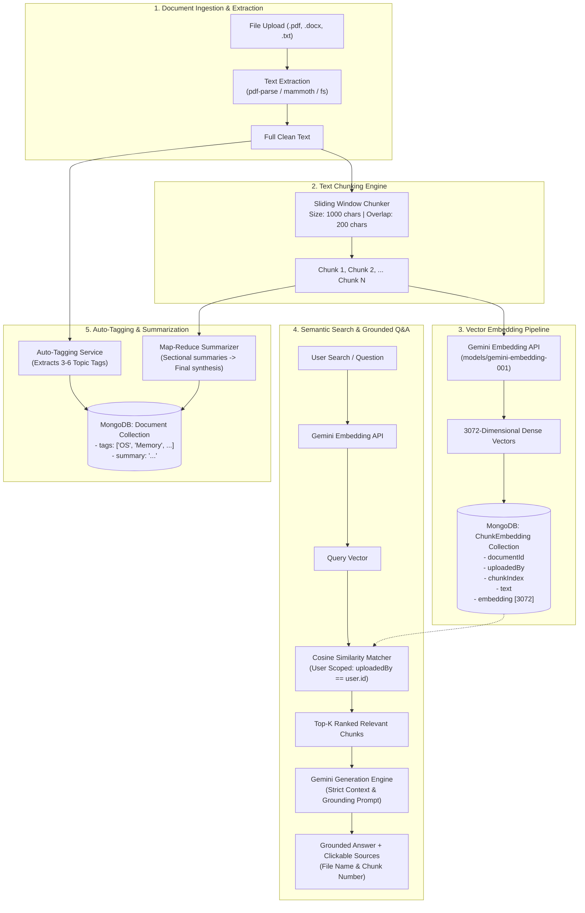

# FileMind — Personal File Intelligence System

FileMind is a full-stack personal knowledge assistant that allows users to securely upload, manage, search, and interact intelligently with their personal documents (PDF, DOCX, TXT) using AI embeddings and grounded LLM synthesis.

---

## 🏛️ System Architecture

The following diagram illustrates how FileMind processes documents from ingestion to intelligent retrieval and response:



---

## 🚀 Key Architectural Modules

1. **Document Ingestion & Multi-Format Parsing**:
   - Handles PDF parsing (`pdf-parse`), Word documents (`mammoth`), and plaintext (`fs`).
   - Validates MIME types, file sizes, and extracts raw text.

2. **Sliding-Window Text Chunking**:
   - Slices document text into **1,000-character windows** with **200-character overlap** to ensure concepts spanning chunk boundaries are never split or lost.

3. **Modular Vector Embeddings**:
   - Converts chunks into **3072-dimensional vector embeddings** using Google Gemini (`gemini-embedding-001`).
   - Persists embeddings in MongoDB with compound indexing (`{ uploadedBy: 1, documentId: 1 }`) for speed and strict user isolation.

4. **Dual Search & Grounded AI Q&A**:
   - **Keyword Search**: Exact regex search matching filenames, extracted text, and chunks.
   - **Semantic Search**: Vector Cosine Similarity matching conceptual meaning rather than exact keywords.
   - **Grounded Q&A**: LLM context answers strictly based on retrieved chunks with citation sources (document name and chunk number).

5. **Summarization & Auto-Tagging**:
   - **Map-Reduce Summarization**: Sectional summaries synthesized into structured Overview, Key Takeaways, and Conclusion.
   - **Automatic Document Tagging**: Automatically detects topics for single-click category filtering and organization.

---

## 🛠️ How to Run

### Backend

```bash
cd backend
npm install
npm run dev
```

Ensure `backend/.env` is configured with:
```env
PORT=5000
MONGO_URI=your_mongodb_connection_string
JWT_SECRET=your_jwt_secret
GEMINI_API_KEY=your_gemini_api_key
GEMINI_MODEL=gemini-3.1-flash-lite
```

### Frontend (React + Vite)

```bash
cd frontend
npm install
npm run dev
```

The frontend will start at `http://localhost:5173`.
