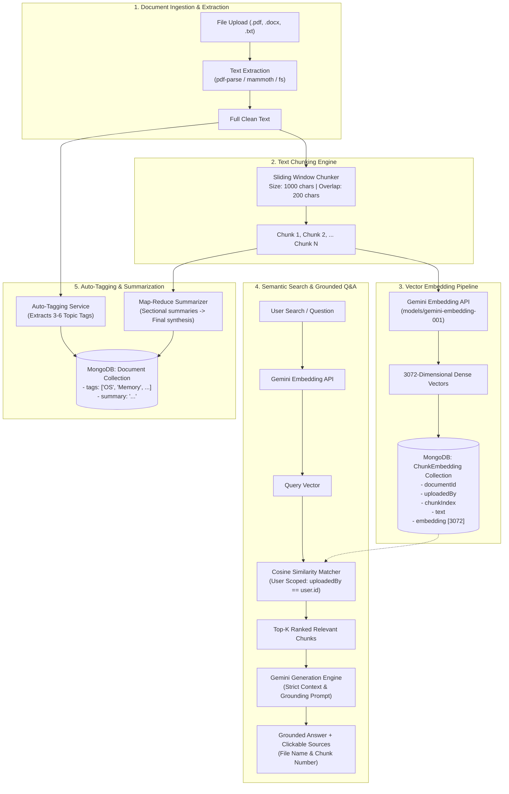

# FileMind — Personal File Intelligence System

## 🏛️ System Architecture



---

## How to Run

### Backend

Open a terminal in the project root:

```bash
cd backend
npm install
npm run dev
```

The backend will start on the configured port, for example:

```text
http://localhost:5000
```

Make sure your `backend/.env` file is configured before starting the server.

---

### Frontend

Open a second terminal in the project root:

```bash
cd frontend
npm install
npm run dev
```

The React + Vite frontend will start at:

```text
http://localhost:5173
```
